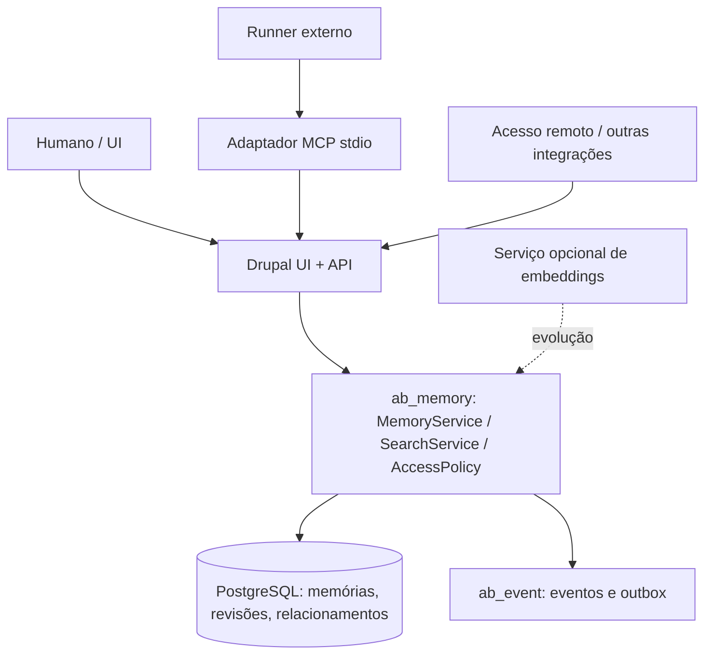

# AgentDock — Fase 2: Memória compartilhada de agentes

Versão: proposta 0.1 — 03/11/2026. Status: planejamento, não implementado.

## 1. Contexto e objetivo

A Fase 1 (M0–M8) está registrada como concluída em `docs/implementation-status.md` (20/10/2026), incluindo integração MCP stdio e runner externo. A Fase 2 adiciona memória durável e consultável a múltiplos agentes e humanos, sem mudar as regras existentes de workspace, autorização, tarefa, execução e lease.

A referência conceitual é AI-Memory 2.0 (Fabio Akita, 02/09/2026): conhecimento em Markdown, versões, colaboração multiagente, handoff, busca e portabilidade. Não se pressupõe interoperabilidade OKF sem validar sua especificação concreta.

### Resultado-alvo

- Agente A registra uma decisão ou aprendizado ao terminar uma tarefa.
- Agente B recupera a informação relevante em outra tarefa, com links para a fonte e versão.
- Humano revisa, corrige, arquiva ou revoga memórias.
- Conhecimento permanece após encerrar uma sessão, sem acesso cruzado entre workspaces.

## 2. Decisões arquiteturais propostas

1. **Memória integrada ao AgentDock**, em novo módulo `ab_memory`, e não ao projeto de acesso remoto. O acesso remoto pode ser consumidor da API/MCP. Lógica de memória fica exclusivamente nos serviços do Drupal.
2. **Escopo obrigatório por workspace**; `board_id` e `task_id` opcionais, mas sempre do mesmo workspace. Visibilidade inicial: `workspace` ou `board`; `private` fica fora do piloto.
3. **PostgreSQL como fonte de verdade**, com conteúdo Markdown versionado e metadados estruturados. Não assumir Git como armazenamento primário no MVP de memória. Exportação Markdown + manifest JSON inicialmente, formato aberto compatível com padrões externos apenas depois de validação formal.
4. **API própria** sob `/api/agent-board/v1/workspaces/{w}/memory`; controlador usa serviços de domínio e `ActorContext`. MCP é adaptador fino sobre HTTP, nunca consulta banco.
5. **Captura explícita inicialmente**, vinculada à execução/tarefa quando existir. Sugestões automáticas a partir de eventos, mensagens e entregas são etapa posterior, com deduplicação e aprovação antes da publicação.
6. **Busca lexical PostgreSQL inicialmente** com filtro de acesso antes do ranking. Busca semântica/híbrida só após experimento mensurável; índices vetoriais e modelo de embeddings são substituíveis, sem dependência obrigatória de provedor externo.
7. **Versionamento otimista**, revisões imutáveis, autoria e auditoria. Conflito de edição não sobrescreve silenciosamente.
8. **Memória não é instrução privilegiada**: conteúdo recuperado é dado não confiável. Não executa comandos, não altera permissões nem injeta instruções de sistema.
9. **Sem execução de LLM dentro do Drupal**; classificação, sumarização e embeddings futuros por worker/serviço opcional. O produto funciona sem chamadas pagas de LLM.

## 3. Arquitetura lógica

A API e a UI utilizam os mesmos serviços. A pesquisa deve filtrar por workspace/board e autorização antes de devolver conteúdo ou contar resultados. Nenhum novo fluxo contorna as verificações de grants, autenticação ou tenancy existentes.

## 4. Modelo de dados proposto

- `ab_memory_entry`: id interno, UUID, workspace_id, board_id opcional, task_id opcional, title, kind (`decision`, `fact`, `procedure`, `lesson`, `summary`), status (`draft`, `published`, `archived`), current_revision_id, tags, created_at, updated_at.
- `ab_memory_revision`: id, entry_id, version inteiro, content_markdown, content_hash, author_type, author_id, source_type (`manual`, `task`, `execution`, `message`), source_id, created_at, change_reason. Unicidade `(entry_id, version)`.
- `ab_memory_link`: from_entry, to_entry, relation (`related`, `supersedes`, `contradicts`, `supports`); somente mesmo workspace; sem links duplicados.
- `ab_memory_source`: referência tipada à origem, com snapshot mínimo e indicação se a fonte ainda pode ser consultada; não duplicar conversas completas.
- `ab_memory_search_index`: projeção reconstruível para busca lexical; não é fonte de verdade.
- Futuro `ab_memory_embedding`: entry_id, revision_id, model, vector, indexed_at, estado; manter isolado do schema inicial.

Revisões publicadas são imutáveis. Edição cria nova revisão; arquivamento não apaga histórico. Exclusão definitiva e retenção exigem política específica, incluindo direito de remoção e limpeza de índices/exportações. Não guardar tokens, chaves, credenciais ou dados pessoais desnecessários.

## 5. Fluxo mínimo de ponta a ponta

1. Agente autorizado consulta `search_memory` antes da execução, em escopo definido pelo token e board.
2. Agente entrega sua tarefa pelo fluxo já existente. Depois sugere ou grava um rascunho de memória com fonte e resumo, sem alterar a tarefa.
3. Humano autorizado revisa e publica (política de publicação do piloto); evento e outbox na mesma transação.
4. Agente de outra execução consulta memórias publicadas, obtém trechos, UUID, revisão e referência de origem.
5. Quando a decisão muda, revisão nova preserva histórico e relacionamento `supersedes` permite identificar informação desatualizada.

## 6. Contratos API/MCP propostos

API, caminhos relativos à base existente:

- `GET /workspaces/{w}/memory?board={uuid}&q=...` — busca autorizada, paginada.
- `POST /workspaces/{w}/memory` — cria rascunho; idempotência obrigatória.
- `GET /workspaces/{w}/memory/{id}` — conteúdo, revisão e fontes.
- `PATCH /workspaces/{w}/memory/{id}` — cria revisão com `If-Match`.
- `POST /workspaces/{w}/memory/{id}/publish` — publicação autorizada.
- `POST /workspaces/{w}/memory/{id}/archive` — arquivamento autorizado.
- `GET /workspaces/{w}/memory/{id}/revisions` — histórico.
- `GET /workspaces/{w}/memory/export` — exportação de escopo autorizado (assíncrona para coleções grandes, futura).

Ferramentas MCP iniciais: `search_memory`, `get_memory`, `create_memory_draft`, `list_memory_revisions`. Publicar/arquivar permanece operação humana inicialmente. Identidade é derivada da credencial do processo; nem agente nem workspace são selecionados livremente em argumentos.

Respostas de busca incluem `memory_id`, `revision`, `title`, `excerpt`, `source`, `updated_at`; retornam no máximo o contexto necessário. `Cache-Control: private, no-store` e erros Problem Details, como na API atual. Definir limites de tamanho antes de implementar.

## 7. Memória, sessões e handoff

Uma tarefa/execução do AgentDock **não é** equivalente a sessão de um agente. Inicialmente, o agente consome memórias por MCP, e uma memória não assume nem mantém lease. Handoff de sessão é evolução separada: registro com owner/session, estado resumido e aceite exclusivo, sem compartilhar contexto privado de um executor com outro. O mecanismo atual de `claim_task` continua sendo a única reserva da tarefa.

## 8. Proteções e qualidade

- Autorização em listagem, busca, contagens, referências, revisão, exportação e indexação.
- Sanitização Markdown, limites de tamanho, proteção contra instruções maliciosas em conteúdo recuperado.
- Garantia de unicidade de revisão e concorrência com `If-Match`; rollback inclui evento/outbox.
- Consultas de agente não revelam memória de board sem grant.
- Observabilidade: quantidade de memórias, taxa de reutilização, falhas de busca, latência p95, revisões e retenção; nunca registrar corpos sensíveis.
- Benchmarks de relevância com conjunto de perguntas e respostas conhecido; não introduzir embeddings antes de medir falhas de busca lexical.

## 9. Fases incrementais

- **F2-M0:** ADRs, contrato, threat model e critérios de aceite.
- **F2-M1:** schema, revisões, autoria, serviço e permissões.
- **F2-M2:** UI de conhecimento, revisão e publicação.
- **F2-M3:** API e MCP de consulta e escrita controlada.
- **F2-M4:** busca lexical, contexto de execução e piloto com dois agentes.
- **F2-M5 (opcional):** captura assistida, busca híbrida e embeddings após benchmark.
- **F2-M6 (futuro):** handoff de sessão, exportação em formato interoperável validado, sincronização entre instalações.

## 10. Fora do MVP de memória

Treinamento de modelos, agentes autônomos que decidem qualquer tarefa, execução de comandos no Drupal, vetorização obrigatória, indexação de segredos, sincronização bidirecional com Git, memória pessoal entre workspaces e handoff automático não autorizado.

## 11. Aceite da fase mínima

Duas credenciais de agentes distintas, em um mesmo workspace e board autorizado: agente A grava rascunho vinculado à tarefa, humano publica, agente B pesquisa e recupera conteúdo com referência e revisão. Agente fora do workspace ou sem grant não consegue encontrar por texto, UUID ou API de revisões. Edição concorrente gera 412; uma revisão antiga continua consultável; rollback não deixa revisões/eventos órfãos. Testes automatizados e cenário real via MCP devem registrar evidências.

## Referências

- `docs/architecture.md` — Fase 1, autorização, eventos, APIs, MCP.
- `docs/backlog.md` — convenção US/T e Definition of Done.
- `docs/implementation-status.md` — evidências da Fase 1.
- https://akitaonrails.com/en/2026/09/02/ai-memory-2-0-best-memory-system-for-agents-and-teams/
