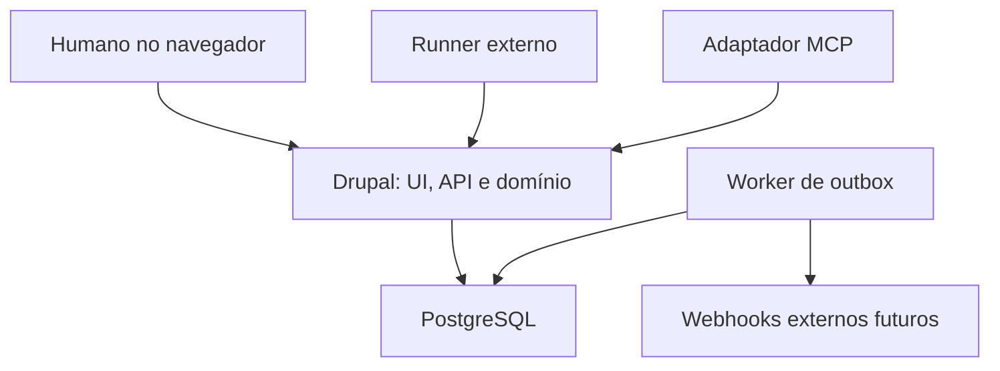

# Board de Agentes — Arquitetura técnica

Versão: 1.0 · Data: 15/10/2026 · Status: proposta implementável para o MVP.

Este documento é a referência inicial para desenvolvimento no Cursor. As escolhas abaixo são decisões propostas, não funcionalidades já implementadas. Nome técnico do projeto: `agent_board`; prefixo dos módulos: `ab_`. Idioma da interface: português do Brasil; código, propriedades e identificadores: inglês.

## 1. Objetivo e limites

Aplicação online em Drupal para organizar tarefas e conversas entre humanos e agentes de diferentes fornecedores. Cada humano pode possuir workspaces e boards privados e convidar colaboradores. Agentes consultam e atualizam tarefas por API; posteriormente, por MCP.

O Drupal é a fonte de verdade para tarefas, permissões, mensagens e execuções. Ele não hospeda modelos de IA nem executa comandos arbitrários enviados em tarefas. A execução ocorre em um runner externo: processo local, CLI, serviço ou ambiente de um agente. Uma integração com Cursor depende das interfaces efetivamente disponíveis no ambiente; não presumir que uma instância aberta do editor possa ser controlada remotamente.

MVP: workspaces, membros, boards, tarefas, agentes, API, execução com reserva, conversa por tarefa e board, notificações internas e sincronização incremental. A comunicação agente–agente acontece por mensagens e menções persistidas, com consumo por runners autorizados.

Fora do MVP: cobrança, marketplace, execução de código na plataforma, seleção automática de agentes, memória vetorial, mensagens diretas privadas entre quaisquer participantes, chat com streaming de tokens, aplicativo móvel, anexos binários e criação autônoma de cadeias de agentes.

## 2. Decisões de arquitetura

| Tema | Decisão inicial | Motivo |
| --- | --- | --- |
| Backend | Drupal 11, versão estável suportada na implementação | Projeto novo, sem dependência do multisite existente |
| PHP | Versão suportada pelo minor escolhido, mínimo compatível com Drupal 11 | Resolver e fixar no Composer e no ambiente |
| Instalação | Uma aplicação Drupal, banco compartilhado, isolamento lógico por workspace | Multisite não representa isolamento entre contas deste produto |
| Banco | PostgreSQL em versão suportada pelo Drupal escolhido | Transações, índices e concorrência |
| Interface | Twig, SDC, Drupal behaviors e JavaScript progressivo | Evita manter uma SPA e autenticação separadas no MVP |
| API | REST própria, JSON, prefixo `/api/agent-board/v1` | Comandos de domínio explícitos |
| Autenticação humana | Sessão Drupal e CSRF nas mutações | Reutiliza o núcleo |
| Autenticação de agente | Bearer token revogável por workspace e agente | Identidade auditável e escopo limitado |
| Sincronização | Polling incremental de eventos | Infraestrutura simples e recuperação por cursor |
| Assíncrono | Outbox no banco e worker Drush persistente | Publicação após commit e tentativas controladas |
| MCP | Adaptador separado sobre a API, após estabilização | Uma única implementação das regras |
| Ambiente local | Lando com serviços compatíveis | Adequado ao fluxo de desenvolvimento Drupal |

Não fixar números de versões de dependências por memória. Na inicialização, verificar requisitos oficiais, resolver Composer, versionar lockfile e registrar versões em ADR. Redis é opcional para cache; não é requisito de correção ou mecanismo primário de exclusão mútua.

## 3. Componentes e fronteiras



UI e API chamam os mesmos serviços de aplicação. Controllers validam transporte e autenticação; serviços aplicam regras e transações; entidades e repositórios persistem dados. Twig, JavaScript, controllers, hooks e adaptador MCP não duplicam regras de transição.

O MVP não exige LLM pago para funcionar: um runner de demonstração determinístico deve completar o fluxo de integração.

## 4. Tenancy, identidade e acesso

Workspace é a fronteira de autorização. Todo objeto de negócio pertence a exatamente um workspace. Referências entre objetos de workspaces diferentes são inválidas, mesmo quando o usuário tem acesso aos dois.

Um board no MVP é visível para membros humanos do workspace. Boards privados de um único usuário ficam em seu workspace pessoal. Permissão humana por board dentro do mesmo workspace é evolução futura. Agentes podem ser limitados a boards específicos desde o MVP.

| Papel no workspace | Permissões |
| --- | --- |
| Owner | Administrar workspace, membros, agentes, credenciais e boards; transferir propriedade |
| Admin | Gerenciar membros não owners, agentes e boards; não remover último owner |
| Member | Criar/editar tarefas, conversar, revisar e aprovar resultados |
| Viewer | Ler boards, tarefas e conversas |
| Agent | Ler e agir somente nos boards e operações concedidos ao seu token |

Papéis de workspace são registros de associação, não roles globais Drupal. A permissão global de administrar a plataforma é reservada a administradores técnicos. Não conceder `administer site configuration` a owners.

Ator autenticado é representado por um value object `ActorContext`: `actor_type` (`human`, `agent`, `system`), identificador, workspace, permissões efetivas e token quando aplicável. A identidade do autor é derivada da autenticação; nunca aceitar `author_id` ou `agent_id` arbitrário no payload.

Para os tokens de agentes, criar um authentication provider Drupal com conta técnica restrita, sem login interativo nem privilégios globais. O `ActorContext` mantém a identidade real do agente. Todas as rotas e serviços aplicam autorização de domínio; a conta técnica, isoladamente, não autoriza acesso a entidades.

Implementar access handlers, access checks das rotas, constraints de referências e filtragem explícita das queries. `accessCheck(TRUE)` em entidades customizadas não deve ser tratado como garantia automática de filtragem por workspace. Listagens, contagens, buscas, autocomplete e eventos também precisam de escopo e testes de isolamento.

Respostas personalizadas da API: `Cache-Control: private, no-store`. Renderizações Drupal usam cache contexts/tags adequados a usuário, workspace e associações. A API retorna 404 para recurso fora do escopo e 403 para operação proibida em recurso visível.

## 5. Modelo de dados

Entidades customizadas de conteúdo para o domínio; campos essenciais em base fields, sem depender de criação manual pela interface. UUIDs públicos; IDs numéricos internos. Usar constraints, índices e foreign keys quando suportados pela modelagem. Campos JSON apenas para metadados não relacionais, com limites e validação.

| Entidade | Campos principais e regras |
| --- | --- |
| `ab_workspace` | UUID, name, owner, timezone, status, created, changed |
| `ab_membership` | workspace, user, role, status; unicidade workspace/user |
| `ab_board` | workspace, name, description, archived; MVP usa fluxo fixo |
| `ab_task` | workspace, board, title, description, acceptance_criteria, status, priority, human_owner, assigned_agent, due_at, position, version, active_execution, created, changed |
| `ab_agent` | workspace, name, description, capabilities, enabled, concurrency_limit |
| `ab_execution` | workspace, task, agent, status, lease_expires_at, heartbeat_at, started_at, ended_at, attempt, result_summary, failure_code, version |
| `ab_thread` | workspace, board, task opcional; um thread geral por board e um por tarefa |
| `ab_message` | workspace, thread, actor_type, actor_id, kind, body, reply_to opcional, execution opcional, created |
| `ab_input_request` | workspace, task, execution, question_message, status, answer_message, created, resolved_at |
| `ab_notification` | workspace, recipient_user, event_id, read_at, created |

Tabelas internas gerenciadas por repositories:

| Tabela | Finalidade |
| --- | --- |
| `ab_task_dependency` | task/dependency; mesmo board, sem ciclos, par único |
| `ab_agent_board_grant` | Agente/board e permissões concedidas |
| `ab_agent_token` | token_id, agent, hash, scopes, expiry, revoked_at, last_used_at |
| `ab_execution_lease` | Reserva exclusiva por tarefa, execution, token_hash, expiry, generation |
| `ab_event` | Eventos duráveis, sequência por workspace, type, resource UUID, actor, payload mínimo |
| `ab_workspace_sequence` | Contador de sequência protegido por transação |
| `ab_outbox` | event_id, destination, attempts, available_at, processed_at, last_error |
| `ab_idempotency` | actor/token, workspace, operation, key, request_hash, response, expiry |
| `ab_message_mention` | Mensagem e destinatário humano/agente, validado no mesmo workspace |

`human_owner` é a pessoa responsável pelo acompanhamento; `assigned_agent` indica a intenção de delegação; `active_execution` indica quem está executando de fato. Não criar um campo de referência ambíguo que misture usuários e agentes.

`ab_task` pode ser revisionável para histórico editorial. Revisões não substituem `version` para controle otimista nem o log de eventos. Mensagens são imutáveis no MVP; edição e moderação ficam para evolução com trilha própria.

Índices mínimos: tasks(workspace, board, status, position); executions(task, status); leases(task UNIQUE); events(workspace, sequence UNIQUE); messages(thread, created, id); membership(workspace, user UNIQUE); tokens(token_id UNIQUE); notifications(recipient_user, read_at); outbox(processed_at, available_at).

## 6. Estados e regras

### Tarefa

| Estado | Significado | Transições normais |
| --- | --- | --- |
| `backlog` | Ainda não liberada | ready, cancelled |
| `ready` | Disponível e com dependências concluídas | in_progress, backlog, cancelled |
| `in_progress` | Execução ativa | in_review, ready, cancelled |
| `in_review` | Entrega aguardando revisão humana | done, ready, cancelled |
| `done` | Aprovada | ready por reabertura humana explícita |
| `cancelled` | Cancelada | backlog por reabertura humana explícita |

Condições paralelas: `blocked` e `waiting_input`, derivadas de dependências ou solicitações abertas. Não são colunas. Tarefa cancelada/done não pode conservar execução ativa. Arrastar card chama comando de transição; não faz alteração irrestrita do campo status.

### Execução

Estados: `running`, `waiting_input`, `submitted`, `failed`, `interrupted`, `cancelled`. Heartbeat só é aceito em `running`/`waiting_input`. `submitted` encerra a execução e leva a tarefa a revisão; `done` exige aprovação humana no MVP. Correção após rejeição cria nova execução, preservando a anterior.

Pedido de informação mantém a reserva, com heartbeat. Expiração interrompe a execução, invalida a reserva e devolve a tarefa a `ready`, conservando o impedimento de informação enquanto não houver resposta. Resposta tardia fica no histórico; a retomada exige nova reserva e contexto atualizado.

Falha explícita encerra a execução, libera a reserva e devolve a tarefa a `ready`. Não há retry automático ilimitado. Tentativas máximas configuráveis; ao atingir o limite, marcar bloqueio para intervenção humana.

Dependências são restritas ao mesmo board no MVP, não podem formar ciclos, e impedem claim enquanto não estiverem em `done`.

## 7. Reserva, concorrência e recuperação

`claim_task` é uma única transação:

1. Autenticar agente e validar grant/scopes.
2. Bloquear a linha do agente para verificar limite de concorrência; depois bloquear tarefa e reserva em ordem consistente.
3. Validar `ready`, atribuição permitida, dependências, ausência de bloqueio e de reserva válida.
4. Criar execução e reserva única, gerar token aleatório de reserva, atualizar task/version.
5. Gravar evento e outbox na mesma transação; confirmar commit.
6. Retornar execução, token da reserva (uma vez), vencimento e versão atual.

Padrão inicial: heartbeat a cada 30 segundos; lease de 120 segundos, configuráveis. Usar relógio UTC do servidor. Toda mutação de execução exige identidade do agente, execução ativa e token válido da reserva; checar vencimento em cada chamada, não apenas no worker.

Um worker procura leases expiradas a cada 15 segundos, com atualização condicional e locks. Marcar execução como interrompida e liberar a tarefa é atômico. Worker repetido não produz transições duplicadas. Restrições de unicidade e transações são a garantia final, além dos locks.

Um agente antigo não pode enviar resultado depois de outro assumir. Token/generation da reserva impedem gravações obsoletas na plataforma. Isso não interrompe comandos que já estão rodando fora do Drupal: runners devem cancelar trabalho local quando perdem a reserva. Efeitos externos, como push e deploy, exigem controles e idempotência no executor externo.

Alterações humanas usam `If-Match` com ETag derivada de `version`; versão obsoleta retorna 412 e ausência do cabeçalho retorna 428. Duas pessoas movendo o mesmo card recebem conflito explícito. Reordenação serializa por board e usa posições inteiras com intervalos; rebalanceamento ocorre em transação. Não permitir last-write-wins silencioso.

## 8. API HTTP

Base: `/api/agent-board/v1`. Contrato OpenAPI deve ser escrito e validado no marco da API. Datas ISO 8601 UTC; paginação por cursor com limite padrão 50 e máximo 100. Tamanho máximo de body: 256 KiB; mensagens: 16 KiB. Descrições e mensagens usam Markdown restrito, renderizado com sanitização e sem HTML arbitrário.

| Método / caminho relativo | Função |
| --- | --- |
| GET `/workspaces` | Workspaces acessíveis |
| GET/POST `/workspaces/{w}/boards` | Listar/criar boards |
| GET/POST `/workspaces/{w}/boards/{b}/tasks` | Listar/criar tarefas com filtros |
| GET/PATCH `/workspaces/{w}/tasks/{t}` | Ler/editar campos permitidos |
| POST `/workspaces/{w}/tasks/{t}/transition` | Transição humana autorizada |
| POST `/workspaces/{w}/tasks/{t}/claim` | Agente assume tarefa |
| POST `/workspaces/{w}/executions/{e}/heartbeat` | Renovar reserva |
| POST `/workspaces/{w}/executions/{e}/progress` | Atualização de progresso |
| POST `/workspaces/{w}/executions/{e}/request-input` | Criar dúvida estruturada |
| POST `/workspaces/{w}/input-requests/{r}/answer` | Resposta humana; resolver dúvida |
| POST `/workspaces/{w}/executions/{e}/submit` | Entregar resultado e links |
| POST `/workspaces/{w}/executions/{e}/fail` | Registrar falha e liberar |
| POST `/workspaces/{w}/executions/{e}/release` | Interromper voluntariamente |
| POST `/workspaces/{w}/tasks/{t}/approve` | Aprovar entrega |
| POST `/workspaces/{w}/tasks/{t}/reject` | Rejeitar com motivo e devolver a ready |
| GET/POST `/workspaces/{w}/threads/{th}/messages` | Conversar |
| GET `/workspaces/{w}/events?after={cursor}` | Sincronização incremental |
| GET `/workspaces/{w}/boards/{b}/snapshot` | Estado consistente inicial do board |
| GET `/workspaces/{w}/agent-inbox?after={cursor}` | Menções e sinais destinados ao agente autenticado |

GET de tarefas aceita `status`, `assigned_agent`, `due_before`, `priority` e cursor; filtros nunca ampliam o escopo autorizado. Gestão de workspaces/membros/agentes/tokens pode começar por formulários Drupal, sem API administrativa completa.

PATCH não aceita workspace, board, status, autor, active_execution ou campos de lease. Agente só modifica tarefas conforme scopes e atribuição; não aprova a própria entrega. Movimentação entre boards fica fora do MVP.

Exemplo de claim:

```http
POST /api/agent-board/v1/workspaces/{workspace_uuid}/tasks/{task_uuid}/claim
Authorization: Bearer <agent_token>
Idempotency-Key: <uuid>
Content-Type: application/json

{}
```

```json
{
  "data": {
    "execution_id": "<uuid>",
    "task_id": "<uuid>",
    "lease_token": "<returned-once>",
    "lease_expires_at": "2026-10-15T10:02:00Z",
    "task_version": 4
  }
}
```

Heartbeat, progress, submit e release usam `X-Execution-Lease` e `Idempotency-Key` além de Bearer. Tokens nunca aparecem em eventos, logs ou URLs. A resposta de claim armazenada para replay idempotente contém segredo: criptografar esse campo com chave fora do banco, TTL limitado, e removê-lo quando a lease encerrar. Alternativamente retornar conflito de recuperação e exigir nova reserva; escolher e documentar antes da implementação. Decisão inicial: replay criptografado pelo prazo da lease.

Mutações de agentes exigem chave idempotente, com escopo workspace/ator/operação; mesmo payload repete resposta, payload diferente com mesma chave retorna 409. Default de retenção: 24h para resultados sem segredo. Idempotência não substitui checagem de lease nas novas operações.

Erros no formato `application/problem+json`, com `type`, `title`, `status`, `detail`, `code`, `request_id`; sem stack trace. Códigos: 401 credencial inválida; 403 sem permissão; 404 fora de escopo/inexistente; 409 claim ou transição conflitante; 412 versão obsoleta; 422 regra inválida; 428 precondição ausente; 429 limite excedido com Retry-After. Claim bem-sucedido: 201; nenhuma tarefa disponível em listagem: 200 com lista vazia.

## 9. Credenciais e proteção

Tokens no formato `ab_<public_id>.<secret>`; secret aleatório com pelo menos 256 bits. Armazenar apenas hash verificável do secret; busca pelo public_id. Exibir uma única vez, com expiração padrão de 90 dias, revogação e rotação. Escopos mínimos: `boards:read`, `tasks:read`, `tasks:write`, `tasks:claim`, `executions:write`, `messages:read`, `messages:write`, `events:read`. Permissão efetiva é a interseção entre token, agente, board e workspace.

MVP: credencial vinculada a um agente em um workspace. Não compartilhar token entre agentes. HTTPS obrigatório; sessões humanas com CSRF e cookies seguros; Bearer nunca deve ser aceito por query string. Tokens de agente não são expostos ao JavaScript da UI.

Limite inicial por token: 120 requisições/minuto, configurável; heartbeat e polling devem caber no orçamento. Separar limites de criação de mensagem para evitar loops. Cache/limites não podem permitir bypass entre réplicas; usar storage compartilhado quando houver mais de uma instância.

Arquivos e mensagens são dados não confiáveis para os agentes. Não converter texto livre em comando automático. Links de entrega são armazenados e exibidos, sem buscar URLs no servidor no MVP. Não guardar chaves de provedores LLM ou GitHub em tarefas.

## 10. Mensagens e sinais

Tipos: `comment`, `progress`, `question`, `answer`, `result`, `system`. Conversa geral de board serve para coordenação; conversa de tarefa concentra decisões e execução. Referências reply_to devem apontar para o mesmo thread.

Texto de menção é acompanhado de destinatários estruturados validados. `@agente` cria sinal na inbox; não inicia execução por si só. Runner pode reagir consultando contexto e pedindo claim quando autorizado. Mensagens agente–agente são possíveis no mesmo board, com registro de origem; o MVP não cria um protocolo de execução arbitrária por chat.

`request-input` cria mensagem + input_request + condição de espera + evento numa transação. `answer` exige humano autorizado, vincula resposta e resolve a solicitação. Todas as solicitações abertas precisam ser resolvidas antes de remover `waiting_input`. Runner recupera respostas por eventos/inbox e consulta o recurso atual.

Orçamento padrão por execução: 50 mensagens de agente e duração máxima de 2 horas, configuráveis. Ao atingir limites, pausar para intervenção humana e encerrar a reserva de forma controlada. Proibir respostas recursivas automáticas a toda mensagem; reações devem usar event_id como chave de deduplicação.

## 11. Eventos e atualização quase em tempo real

Eventos essenciais: task.created, task.updated, task.claimed, execution.progressed, execution.interrupted, execution.submitted, task.approved, task.rejected, message.created, input.requested, input.answered e membership.changed.

Evento contém event_id UUID, workspace, sequence, type, resource UUID, actor, timestamp e payload mínimo. Não incluir texto privado ou segredo desnecessário.

Garantia de ordenação: incrementar contador por workspace sob lock dentro da mesma transação de negócio; gravar evento/outbox antes de commit. Um BIGSERIAL global isolado não garante ordem de commit e pode causar perda no polling por cursor. Publicar apenas eventos confirmados.

O snapshot retorna tarefas e `cursor` obtidos sob visão consistente do banco. Depois, cliente consulta eventos posteriores. Eventos são filtrados pelo acesso atual, inclusive grants de board do agente. Cursor representa avanço no fluxo inspecionado, mesmo quando eventos foram filtrados; não vazar payloads ou contagens de boards não autorizados.

Polling da UI: 3 segundos com aba ativa; 15 segundos com aba oculta; backoff com jitter até 60 segundos em falhas. Não sobrepor requisições. Reautenticação em 401; revalidar acesso em 403/404. Eventos invalidam cards/threads; cliente recarrega recursos necessários e elimina duplicações por event_id.

Retenção inicial dos eventos de sincronização: 30 dias, configurável. Cursor anterior à retenção retorna 410 com `resync_required`; obter novo snapshot. Auditoria pode exigir retenção diferente e não deve depender apenas desse fluxo descartável.

Meta inicial: alteração visível em até 5 segundos em condições normais. SSE é evolução: serviço dedicado consome outbox e entrega apenas eventos autorizados, sem manter PHP-FPM ocupado com conexões longas. API continua sendo fonte de verdade.

## 12. Runner e MCP

Runner de referência pode ser um pequeno CLI Python ou TypeScript, escolhido no marco de integração. Configuração por variáveis de ambiente: API URL, token e intervalo. Estado local mínimo: cursor, execução ativa e chaves idempotentes; segredos fora do repositório.

Loop: consultar inbox/tarefas prontas → escolher tarefa elegível → claim → carregar contexto → trabalhar mantendo heartbeat → enviar progresso/dúvidas → submit ou fail. Em perda de lease, parar novas ações e cancelar subprocessos quando possível. Reconexão sempre valida execução antes de retomar.

MCP posterior expõe `list_boards`, `list_ready_tasks`, `get_task`, `claim_task`, `report_progress`, `post_message`, `request_human_input`, `get_execution`, `submit_result`, `fail_execution`, `release_task` e `get_agent_inbox`. O adaptador chama API com credencial do agente; não acessa banco diretamente.

Sessão MCP ou conexão HTTP não equivale a execução. Heartbeat precisa ser mantido por runner/serviço enquanto há trabalho ativo; uma chamada MCP isolada não garante isso. Primeiro transporte recomendado: stdio local; avaliar HTTP remoto e autenticação compatível com os clientes somente no marco MCP.

## 13. Estrutura Drupal

```text
web/modules/custom/
  ab_core/           # workspace, membership, ActorContext, autorização
  ab_board/          # board, task, dependências, ordenação, transições
  ab_agent/          # agentes, tokens, grants, execução e leases
  ab_communication/  # threads, mensagens, menções e pedidos de informação
  ab_event/          # eventos, contador, outbox, worker, sincronização
  ab_api/            # rotas HTTP, DTOs, validação, OpenAPI, rate limit
  ab_ui/             # controllers, formulários, libraries e behaviors
web/themes/custom/agent_board/
  components/
  templates/
  css/
  js/
docs/
  architecture.md
  adr/
  openapi.yaml
  runbooks/
tools/agent-runner/
tools/mcp-adapter/    # criado apenas na etapa MCP
```

Dependências: core é base; board depende de core; agent depende de board; communication depende de agent; API/UI compõem serviços. `ab_event` oferece mecanismo genérico de evento/outbox sem depender de implementações de tarefa ou agente. Serviços de domínio gravam eventos através de interface, evitando dependência circular.

Serviços centrais: WorkspaceAccessPolicy, TaskTransitionService, TaskClaimService, ExecutionService, LeaseService, MessageService, InputRequestService, EventStore, OutboxProcessor, IdempotencyService e BoardSnapshotService. Usar injeção de dependência, ClockInterface e repositórios testáveis.

JSON:API não é a API pública do produto. Desabilitar exposição das entidades internas por JSON:API/REST genérico ou não habilitar esses módulos. Não deixar caminhos alternativos que ignorem comandos de domínio. Escritas programáticas devem atravessar serviços; constraints reforçam invariantes de dados.

## 14. Interface do MVP

Telas: login; meus workspaces; boards; kanban; detalhe da tarefa; conversa geral do board; agentes/credenciais; membros; notificações.

Card mostra título, prioridade, prazo, humano responsável, agente e condição de bloqueio/espera. Detalhe da tarefa mostra descrição, critérios, dependências, conversa, execução atual, tentativas e entrega. Ações humanas: mover, editar, responder, cancelar execução, aprovar e rejeitar.

Além do board completo, fornecer filtro “Hoje”: tarefas vencidas ou com prazo no dia do workspace, mais execuções em andamento; não mover nem arquivar tarefas automaticamente à meia-noite. Persistir datas em UTC e calcular o dia pelo timezone do workspace, padrão `America/Sao_Paulo`.

Fluxo fixo no MVP. Colunas configuráveis futuras devem separar coluna visual de estado semântico. Drag-and-drop tem alternativa por botão/menu e uso por teclado. Layout responsivo e textos de erro claros. Credenciais só aparecem no formulário de geração.

## 15. Operação e observabilidade

Produção inicial: proxy HTTPS, PHP-FPM/Drupal, PostgreSQL e processo worker supervisionado. Worker executa comando Drush próprio com loop, encerramento gracioso e limites de memória; cron é usado para manutenção, não como único mecanismo de execução rápida.

Outbox tem processamento pelo menos uma vez: reivindicar itens com lock, timeout de processamento, retries exponenciais e limite de tentativas; deduplicar efeitos por event_id/destino. Falha permanente vai para estado de erro inspecionável e reprocessável. Webhooks externos não fazem parte do primeiro MVP; quando incluídos, exigir assinatura, timeout e proteção contra SSRF.

Logs estruturados: request_id, workspace_id, actor, task_id, execution_id e event_id, sem tokens/corpos sensíveis. Métricas: leases expiradas, idade da outbox, falhas por endpoint, latência, workers ativos e taxa de polling.

Backups do banco e arquivos, com teste de restauração. Segredos em variáveis/secret manager; configurações Drupal exportadas em Git. Deploy executa backups conforme política, `drush updb`, `drush cim` e `drush cr`, com health check. Restore do banco não desfaz efeitos que agentes já produziram em serviços externos.

Meta de validação inicial, não promessa de capacidade: 20 humanos simultâneos, 10 agentes ativos, 10 boards e 5.000 tarefas no ambiente de teste. Medir antes de definir capacidade comercial.

## 16. Testes obrigatórios

| Grupo | Evidência esperada |
| --- | --- |
| Isolamento | Usuário/agente A não lê, conta, altera ou recebe eventos de workspace B |
| Grants de board | Agente restrito não acessa outro board, mesmo com UUID conhecido |
| Claim simultâneo | Duas conexões reais concorrentes: apenas uma execução ativa |
| Limite de agente | Claims concorrentes não ultrapassam concurrency_limit |
| Lease | Heartbeat renova; expiração bloqueia escrita; worker é idempotente |
| Escrita obsoleta | Execução antiga não entrega resultado após novo claim |
| Idempotência | Retry não duplica mensagem/execução; payload divergente gera conflito |
| Estados | Agente não aprova entrega; dependência e ciclo são validados |
| Eventos | Rollback não publica; sequência e snapshot não perdem commits |
| Mensagens | Autor não pode ser forjado; HTML é sanitizado; menção não executa comando |
| Autenticação | Token revogado/expirado falha; sessão humana exige CSRF |
| UI | Movimento por teclado, conflito de versão e reconexão funcionam |

Usar PHPUnit unitário para regras, Kernel para entidades/transações/acesso e testes funcionais para API/UI. Teste de concorrência precisa de processos/conexões independentes, não chamadas sequenciais. CI: Composer validate, padrões Drupal, análise estática configurada, PHPUnit e validação OpenAPI.

## 17. Marcos de implementação para o Cursor

### M0 — Fundação

Criar projeto Composer, ambiente local, módulos vazios, tema, configuração exportável, CI e ADRs das versões resolvidas. Aceite: instalação reproduzível, Drush funcional e pipeline básico passando. Não iniciar integrações de IA.

### M1 — Workspace e acesso

Implementar entidades workspace/membership, roles de domínio, workspace pessoal e política de acesso. Aceite: dois usuários com dados isolados, incluindo listagens e cache; último owner protegido. Convites por email ficam para evolução; MVP permite inclusão administrativa de usuário já cadastrado.

### M2 — Board e tarefas

Implementar board, tarefas, estados, dependências, versão otimista, ordenação e UI acessível. Aceite: criar/mover/editar, rejeitar ciclos e mostrar conflitos simultâneos. Entregas podem ser simuladas até M3.

### M3 — Agentes e execução

Implementar tokens, grants, ActorContext, claim transacional, lease, heartbeat, submit/fail/release e aprovação. Aceite: testes concorrentes e de credenciais; uma única execução ativa por tarefa.

### M4 — Conversas

Implementar threads de board/tarefa, mensagens, menções, input requests e notificações internas. Aceite: agente pede ajuda, humano responde, runner recupera resposta sem disparar loops.

### M5 — API e runner de referência

Consolidar OpenAPI, idempotência, erros, paginação e limites. Implementar runner determinístico. Aceite: executar ciclo criar → claim → progresso → pergunta → resposta → submit → aprovação usando HTTP, sem acesso direto ao banco.

### M6 — Sincronização e operação

Implementar snapshot consistente, cursor de eventos, polling da UI/inbox, outbox e worker de expiração supervisionado. O mecanismo transacional de eventos já deve existir nos marcos anteriores; aqui entram consumo e operação completos. Aceite: duas abas sincronizam em até 5 segundos no teste, reconexão não perde eventos, worker recupera leases.

### M7 — Piloto e revisão

Rodar um humano e dois runners com credenciais distintas, validar permissões, backups, logs e carga inicial. Aprovar arquitetura operacional e corrigir falhas antes de adicionar integrações reais.

### M8 — MCP e integrações reais

Adicionar adaptador MCP e uma integração de agente real por vez. Validar cliente, autenticação, ambiente executor, heartbeat e cancelamento. Aceite: repetir o fluxo do runner via integração real e documentar suas limitações.

## 18. Instrução inicial para colar no Cursor

```text
Leia docs/architecture.md por completo. Este documento é a referência do produto Board de Agentes.

Comece somente pelo marco M0. Inspecione o repositório e AGENTS.md antes de modificar arquivos. Se o projeto já existir, preserve seu trabalho e adapte a fundação sem recriar a instalação.

Verifique requisitos oficiais das versões Drupal/PHP/PostgreSQL e dependências; fixe versões resolvidas e registre as decisões em docs/adr. Configure instalação reproduzível, módulos ab_* vazios, tema agent_board, ambiente local e CI básico.

Não implemente todos os marcos de uma vez. Ao concluir cada marco, apresente arquivos alterados, decisões, comandos de validação, resultados reais e lacunas. Não declare testes executados sem executá-los. Mantenha docs/implementation-status.md atualizado.

Regras permanentes: isolamento por workspace em toda leitura e escrita; regras nos serviços; comandos de domínio em vez de PATCH irrestrito; UUIDs públicos; segredos fora do Git; eventos e outbox na transação de negócio; claim atômico; uma execução ativa por tarefa; aprovação humana de entrega; testes reais para concorrência.

Se uma dependência não for compatível, proponha alternativa mínima e registre ADR. Não substitua o backend Drupal, introduza SPA, serviço LLM, Redis obrigatório ou infraestrutura de streaming sem necessidade demonstrada.
```

## 19. Evoluções após o MVP

Boards privados dentro de workspace; colunas customizadas; anexos em storage privado; chat direto; webhooks assinados; SSE; OAuth para integrações de terceiros; templates de tarefas e rotinas diárias; métricas de custo e duração; delegação entre agentes com orçamento; integrações GitHub/Slack; agendamento e capacidade de agentes.

Nenhuma dessas evoluções deve comprometer o contrato de autorização ou colocar regras de domínio exclusivamente no adaptador MCP.

## 20. Fontes técnicas a conferir na implementação

- Requisitos PHP do Drupal: https://www.drupal.org/docs/getting-started/system-requirements/php-requirements
- Requisitos iniciais do Drupal 11: https://www.drupal.org/about/core/blog/drupal-110-will-require-php-83-and-mysql-80
- Documentação de entidades Drupal: https://www.drupal.org/docs/drupal-apis/entity-api
- Especificação MCP: https://modelcontextprotocol.io/specification
- HTTP Problem Details: https://www.rfc-editor.org/rfc/rfc9457

Requisitos Drupal consultados em 15/10/2026. As demais referências são pontos de validação para a implementação; o documento não certifica compatibilidade de um cliente MCP ou módulo contribuído específico.

## 21. Referências visuais da interface

As telas de referência estão em `docs/screens/` e devem ser
consultadas antes de implementar ou alterar qualquer interface.

### 21.1 Como utilizar

- Identificar as telas relacionadas ao marco em desenvolvimento.
- Seguir os padrões visuais de navegação, cores, tipografia,
  espaçamento, componentes e hierarquia apresentados nas telas.
- Implementar os estados complementares: carregamento, vazio,
  erro, acesso negado e confirmação de ações.
- Adaptar os layouts para dispositivos móveis e uso por teclado.
- Reutilizar componentes por meio de Twig, SDC e libraries Drupal.

### 21.2 Relação com a arquitetura

Este documento define regras de negócio, permissões, modelo de
dados e contratos de integração. As telas definem a referência
visual e a organização da interface.

Elementos visíveis nas telas não tornam uma funcionalidade
automaticamente parte do MVP. Se uma tela apresentar recursos
previstos para etapas futuras, registrar a diferença antes de
implementá-los.

Em caso de conflito, preservar as regras da arquitetura e
documentar o ajuste visual necessário.